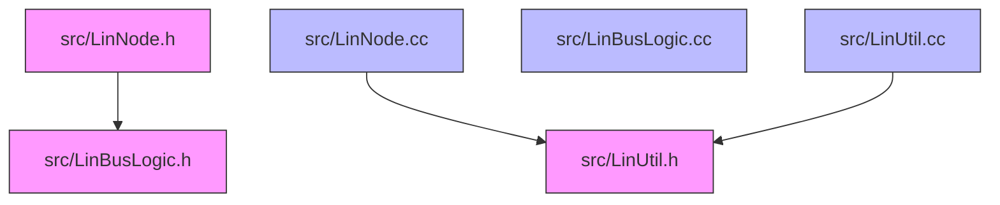

# Architecture Documentation

This document describes the architectural structure and internal file dependencies of the codebase based on the provided dependency graph.

---

## 1. Overview

The codebase consists of three primary functional components located in the `src/` directory:
1. **LIN Node (`LinNode`)**: Handles node-level logic and references bus logic and utility modules.
2. **LIN Bus Logic (`LinBusLogic`)**: Defines central or bus-level logic.
3. **LIN Utilities (`LinUtil`)**: Provides common utility header definitions and implementations used across components.

---

## 2. File and Component Structure

### Core Components

* **`src/LinNode.h` & `src/LinNode.cc`**
  * **Role**: Defines and implements node functionality.
  * **Entities**: Uses `cSimpleModule`.
  * **Dependencies**: 
    * `src/LinNode.h` depends on `src/LinBusLogic.h`.
    * `src/LinNode.cc` depends on `src/LinUtil.h`.

* **`src/LinBusLogic.h` & `src/LinBusLogic.cc`**
  * **Role**: Defines and implements bus logic.
  * **Entities**: Uses `cSimpleModule`.
  * **Dependencies**: None declared in the graph.

* **`src/LinUtil.h` & `src/LinUtil.cc`**
  * **Role**: Provides utility definitions and helper implementation.
  * **Entities**: Contains `LinUtil.h`.
  * **Dependencies**: 
    * `src/LinUtil.cc` depends on `src/LinUtil.h`.

---

## 3. Key Entities

| Entity | Declared / Used In File(s) | Description |
| :--- | :--- | :--- |
| `cSimpleModule` | `src/LinNode.h`, `src/LinBusLogic.h` | Base or core module entity utilized by both Node and Bus Logic definitions. |
| `LinUtil.h` | `src/LinUtil.h` | Key utility entity present within the utility header. |

---

## 4. Dependency Graph Diagram

The following Mermaid diagram depicts the file-level dependencies within the project:

---

## 5. Architectural Summary

* **Central Utilities**: `LinUtil.h` serves as a shared utility header depended upon by both `LinUtil.cc` and `LinNode.cc`.
* **Bus Logic Integration**: `LinNode.h` includes `LinBusLogic.h`, establishing a link between node representations and bus logic interface definitions.
* **Module Commonality**: Both `LinNode.h` and `LinBusLogic.h` share the `cSimpleModule` entity.